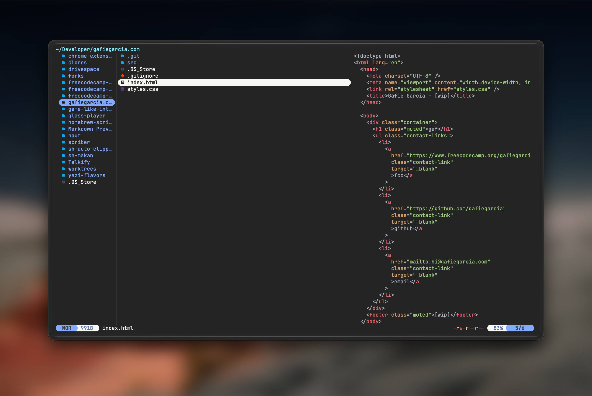

# One Dark Syntax with yazi default theme

Yazi flavor with default UI theme and One Dark Syntax-highlighting from [andresmichel/one-dark-theme](https://github.com/andresmichel/one-dark-theme/)

## 👀 Preview



## 🎨 Installation

<!-- Please replace "username/example" with your repository name. -->

```sh
ya pkg add gafiegarcia/onehalfdark-default-ui

```

## ⚙️ Usage

<!--
Please replace "example" with your flavor name.

If your flavor uses a light color scheme, use "light" instead of "dark" wherever it appears below.
-->

To set it as your dark flavor, change the content of your `theme.toml` to:

```toml
[flavor]
dark = "example"
```

Make sure your `theme.toml` doesn't contain anything other than `[flavor]`, unless you want to override certain styles of this flavor.

See the [Yazi flavor documentation](https://yazi-rs.github.io/docs/flavors/overview) for more details.

## 📜 License

The flavor is MIT-licensed, and the included tmTheme is also MIT-licensed.

Check the [LICENSE](LICENSE) and [LICENSE-tmtheme](LICENSE-tmtheme) file for more details.
